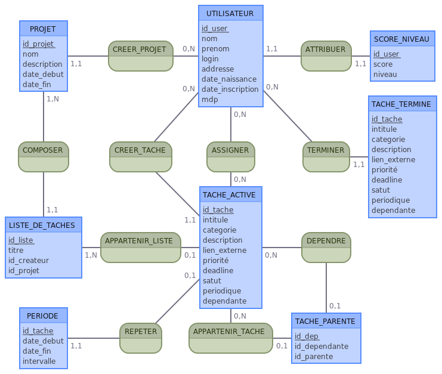
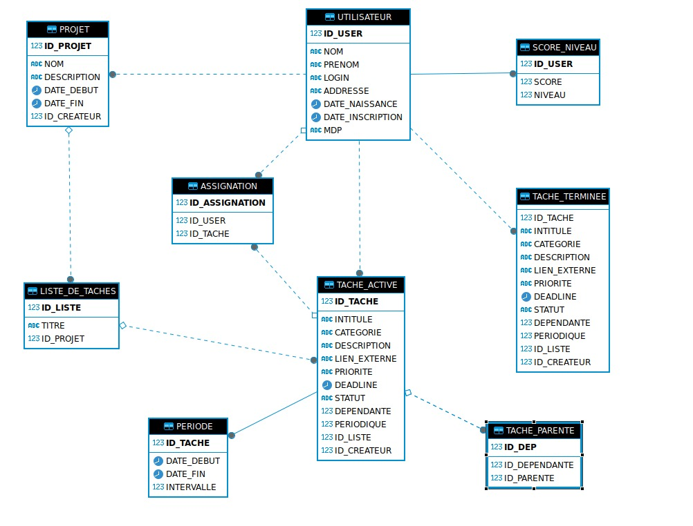

# Base de données d'une application de gestion des tâches

Projet de Licence 3 Informatique (Université de Strasbourg) : conception complète, de zéro, de la base de données d'une application de gestion de tâches (projets, listes, tâches assignées, tâches dépendantes ou périodiques, score des utilisateurs), puis création du schéma sous Oracle et écriture de requêtes SQL pour l'interroger.

## En bref

| | |
|---|---|
| **Domaine** | Application de gestion de tâches : projets, listes, tâches, assignations, dépendances, périodicité, score |
| **Modélisation** | Modèle conceptuel (entités-associations, cardinalités) puis modèle logique : 9 tables |
| **SGBD** | Oracle (testé sur Oracle Database 23ai Free) |
| **Contraintes** | Clés primaires et étrangères, unicité, `CHECK` métier (dates cohérentes, priorités et statuts autorisés, pas d'auto-dépendance), index sur les clés de jointure |
| **Requêtes** | 12 requêtes : jointures multiples, agrégations conditionnelles, sous-requêtes `NOT EXISTS`, `UNION ALL`, requête récursive, fonction analytique `RANK`, `ROLLUP` |

## Modélisation

### Modèle conceptuel



### Modèle logique



Choix de modélisation :

- **Tâches actives et terminées dans deux tables.** Une tâche terminée quitte `TACHE_ACTIVE` pour `TACHE_TERMINEE` : la table consultée en permanence reste légère, et l'historique est conservé.
- **Dépendances entre tâches** (`TACHE_PARENTE`) : une tâche peut attendre une ou plusieurs tâches parentes, ce qui permet de calculer les tâches bloquées et les chaînes de dépendances.
- **Tâches périodiques** : la période (début, fin, intervalle) est isolée dans `PERIODE`, liée en 1,1 à la tâche, au lieu d'alourdir toutes les tâches.
- **Assignation plusieurs-à-plusieurs** entre utilisateurs et tâches (`ASSIGNATION`).
- **Score et niveau** dans une table à part (`SCORE_NIVEAU`), en relation 1,1 avec l'utilisateur.

## Contenu

| Fichier | Rôle |
|---|---|
| [`sql/01_creation_tables.sql`](sql/01_creation_tables.sql) | Création des 9 tables, des contraintes et des index, puis insertion d'un jeu de démonstration (4 utilisateurs, 3 projets, 7 tâches actives, 4 terminées) |
| [`sql/02_requetes.sql`](sql/02_requetes.sql) | 12 requêtes d'interrogation commentées |

Les requêtes répondent à des questions concrètes : tableau de bord d'un projet, tâches en retard, charge de travail par utilisateur, utilisateurs sans tâche, avancement de chaque projet, projets terminés, chaîne de dépendances avant une mise en production, tâches réellement bloquées, classement par score, prochaine occurrence des tâches périodiques, respect des délais, répartition par priorité et statut avec sous-totaux.

## Exécuter

Avec Oracle Database Free dans Docker :

```bash
docker run -d --name oracle-taches -p 1521:1521 \
  -e ORACLE_PASSWORD=motdepasse -e APP_USER=taches -e APP_USER_PASSWORD=taches \
  gvenzl/oracle-free:23-slim-faststart

# une fois la base prête (docker logs oracle-taches affiche « DATABASE IS READY TO USE »)
docker cp sql oracle-taches:/tmp/sql
docker exec -it oracle-taches sqlplus taches/taches@FREEPDB1 @/tmp/sql/01_creation_tables.sql
docker exec -it oracle-taches sqlplus taches/taches@FREEPDB1 @/tmp/sql/02_requetes.sql
```

Le jeu de démonstration utilise des dates relatives à `SYSDATE` : les requêtes sur les retards et les échéances donnent un résultat parlant quelle que soit la date d'exécution.

## Choix d'implémentation

- `TACHE_TERMINEE.date_fin` : date de clôture, qui permet de mesurer le respect des délais (requête R11).
- Valeurs autorisées contrôlées par `CHECK` : priorité (`basse`, `moyenne`, `haute`) et statut (`a_faire`, `en_cours`, `bloquee`, `terminee`).
- Index sur les clés étrangères utilisées dans les jointures, et règles `ON DELETE` choisies selon le sens de chaque lien (suppression en cascade des assignations, liste mise à `NULL` si elle est supprimée).

## Limites et améliorations possibles

- Le passage d'une tâche de `TACHE_ACTIVE` à `TACHE_TERMINEE` n'est pas automatisé : une procédure PL/SQL transactionnelle (copie, suppression et mise à jour du score) serait l'étape suivante.
- Le mot de passe est stocké sous forme d'empreinte dans le modèle, mais le jeu de démonstration utilise des valeurs factices.
