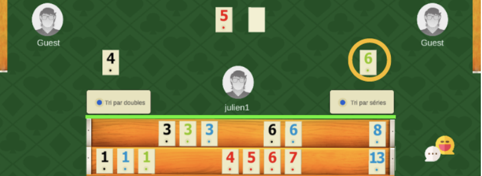

# Okey

Réimplémentation numérique multijoueur du **Okey**, un jeu de tuiles pour 2 à 4 joueurs très populaire en Turquie. Le projet comprend un client de jeu (Unity), une API et un serveur temps réel (ASP.NET Core), un site vitrine, ainsi que toute l'infrastructure Docker/CI-CD nécessaire pour le faire tourner.

> **Projet universitaire** — réalisé dans le cadre d'un module de Licence 3 Informatique (Université de Strasbourg), en équipe de 10 étudiants, sur plusieurs mois, avec méthodologie de développement collaborative (GitLab flow, revues de code, CI/CD).
>
> **Ma contribution** : développement du client de jeu Unity (`client/OkeyClient`).
> - **Écrans d'accueil** : connexion, création de compte, profil et paramètres (`Assets/Code/Scripts/PageAccueil/`)
> - **Plateau de jeu** : affichage du plateau et du chevalet, manipulation des tuiles pendant la partie (`Assets/Code/Scripts/Plateau/`)
> - **Communication temps réel** : connexion au serveur SignalR et échange des paquets de jeu côté client (pioche, défausse, tuiles jetées, début de partie) (`Assets/Code/Scripts/SignalR/`)

## Aperçu



_Une partie en cours dans le client Unity (capture issue de la page des règles du site vitrine, d'où l'annotation en jaune)._

## Stack technique

| Composant | Technologie |
|---|---|
| Client de jeu | Unity 2022.3.19f1 LTS (C#) |
| API REST | ASP.NET Core 8 (.NET 8), Entity Framework Core |
| Serveur temps réel | ASP.NET Core SignalR |
| Site vitrine | Node.js, Express |
| Base de données | MySQL 8 |
| Conteneurisation | Docker, Docker Compose |
| CI/CD | GitLab CI/CD |

## Architecture

Monorepo organisé en plusieurs sous-projets :

- **`client/OkeyClient/`** — client de jeu Unity (interface, logique de jeu côté client, animations, communication avec l'API et le serveur temps réel)
- **`server/OkeyApi/`** — API REST : comptes utilisateurs, authentification (JWT), classements, succès
- **`server/OkeyServer/`** — serveur temps réel (SignalR) : logique de jeu en direct, synchronisation des parties multijoueur
- **`server/okeywebsite/`** — site web vitrine du projet (Express)
- **`docker/`** — Dockerfiles et configuration Docker Compose pour lancer toute la stack backend en local ou en production

## Lancer le backend en local

Prérequis : [Docker](https://docs.docker.com/get-docker/) et [Docker Compose](https://docs.docker.com/compose/).

```sh
cd docker
cp .env.example .env   # valeurs par défaut suffisantes pour un usage local
docker compose --profile core build
docker compose --profile core up -d
```

Une fois les conteneurs démarrés (laisser quelques secondes à la base de données pour s'initialiser) :

- Site web : <http://localhost/>
- API : <http://localhost/okeyapi/>
- Serveur temps réel (SignalR) : `ws://localhost:10000/OkeyHub`

Pour tout arrêter : `docker compose --profile core down`.

## Lancer le client Unity

Le client nécessite [Unity Hub](https://unity.com/download) et l'éditeur **Unity 2022.3.19f1 LTS**. Une fois le projet ouvert dans l'éditeur (`client/OkeyClient`), utiliser le menu `MyTools > Test Build` pour générer un exécutable configuré pour se connecter au backend lancé en local (`http://localhost/`).

## Contexte académique

Ce dossier est une republication personnelle, à des fins de portfolio, d'un projet initialement développé sur une instance GitLab privée de l'Université de Strasbourg, en équipe de 10 étudiants. L'historique de commits original (attribuant le travail à chaque membre de l'équipe) n'est pas repris ici ; seule ma contribution personnelle (le client Unity) est mise en avant dans la section ci-dessus.
