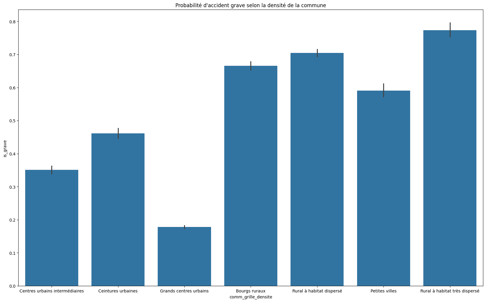
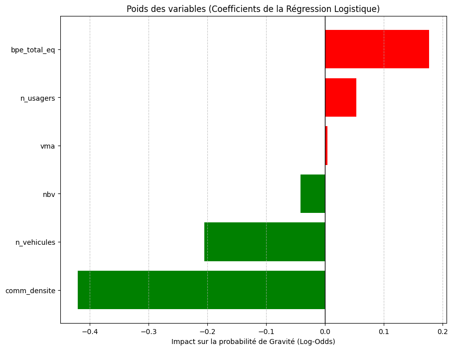

# Prédiction de la gravité des accidents de la route en France

Projet réalisé dans le cadre du M1 SDSC (Sciences de Données et apprentissage) à l'Université de Strasbourg, en groupe de trois. Il croise les données officielles des accidents corporels de la route (BAAC 2024) avec des données territoriales (équipements des communes, densité de population) pour étudier et prédire la gravité des accidents.

## Objectif

L'objectif est de répondre à la question suivante : peut-on prédire si un accident corporel de la route sera grave (au moins un blessé hospitalisé ou un décès), et comment cette probabilité varie-t-elle selon la densité de population et le niveau d'équipements de la commune où l'accident se produit ? Le projet construit d'abord un jeu de données unique à partir de plusieurs sources, puis compare plusieurs modèles de classification supervisée sur cette tâche.

## Travail réalisé

Le notebook `projet_sda.ipynb` suit ces étapes :

1. **Construction du jeu de données** — fusion des quatre tables BAAC 2024 (Caractéristiques, Lieux, Usagers, Véhicules) autour de l'identifiant `Num_Acc`, avec agrégation au niveau accident (une ligne par accident, plusieurs usagers possibles par accident).
2. **Enrichissement territorial** — jointure avec la Base Permanente des Équipements (BPE, INSEE) agrégée par commune, et avec le jeu de données "Communes et villes de France" pour ajouter population, densité, altitude et zone d'emploi.
3. **Nettoyage** — suppression des colonnes quasi vides ou constantes, des identifiants et libellés peu informatifs, et des indicateurs binaires redondants du BPE ; imputation de la densité communale manquante par le mode.
4. **Construction de la cible** — variable binaire `is_grave` (1 si au moins un usager tué ou hospitalisé, 0 sinon), construite à partir de la variable `grav` de la table Usagers.
5. **Analyse descriptive** — étude de la répartition des accidents et de leur gravité selon la densité communale et le niveau d'équipements, et des corrélations avec la gravité.
6. **Sélection des features** — décodage des variables catégorielles BAAC en libellés explicites, encodage one-hot, puis filtrage des modalités trop rares (fréquence < 5 %) pour réduire le nombre de variables de 70 à 36.
7. **Modélisation** — entraînement et comparaison de six modèles supervisés (régression logistique pondérée, arbre de décision, Random Forest, Gradient Boosting, AdaBoost, KNN) sur un split train/test stratifié (80/20).
8. **Évaluation et interprétation** — comparaison des modèles sur accuracy, précision, rappel et F1-score par classe ; lecture des coefficients de la régression logistique, de l'importance des variables du Random Forest et d'un arbre de décision peu profond (profondeur 3) pour l'explicabilité.

## Compétences mises en pratique

| Compétence | Application dans ce projet |
|---|---|
| Fusion et agrégation de données tabulaires | Jointures `merge`/`groupby` entre 6 fichiers sources (BAAC ×4, BPE, Communes) avec gestion des relations one-to-many et validation explicite (`validate=`) |
| Nettoyage de données réelles | Harmonisation d'identifiants (espaces insécables, BOM), suppression de doublons, imputation ciblée, retrait de colonnes quasi constantes |
| Feature engineering | Décodage de codes BAAC en libellés, encodage one-hot, filtrage par seuil de fréquence pour limiter la dimension |
| Gestion du déséquilibre de classes | Pondération des classes (`class_weight='balanced'`) et choix de métriques adaptées (F1, rappel) plutôt que la seule accuracy |
| Modélisation supervisée comparative | Entraînement et comparaison de 6 algorithmes de classification (linéaire, arbres, boosting, instance-based) sur les mêmes données |
| Interprétabilité de modèles | Lecture de coefficients de régression logistique (odds ratio), importance des variables (Random Forest), visualisation d'un arbre de décision |
| Visualisation de données | Graphiques de distribution, de corrélation et de comparaison de performances avec matplotlib/seaborn |

## Outils utilisés

Bibliothèques Python effectivement importées dans le notebook :
- **pandas**, **numpy** — manipulation et agrégation des données
- **matplotlib**, **seaborn** — visualisation
- **scikit-learn** — modélisation (`LogisticRegression`, `RandomForestClassifier`, `GradientBoostingClassifier`, `AdaBoostClassifier`, `KNeighborsClassifier`, `DecisionTreeClassifier`), prétraitement (`StandardScaler`, `train_test_split`) et métriques (`classification_report`, `precision_recall_fscore_support`, etc.)

Le notebook s'exécute dans un environnement Jupyter (kernel Python).

## Principaux résultats

Les chiffres ci-dessous ont été vérifiés en ré-exécutant le notebook complet de bout en bout dans un environnement propre (voir [Exécuter le projet](#exécuter-le-projet)) ; ils ne sont donc pas de simples copies de sorties passées.

- **Déséquilibre de classes** : 63,9 % d'accidents légers contre 36,1 % d'accidents graves.
- **Comparaison des modèles** (accuracy globale / F1-score sur la classe « Grave ») :

  | Modèle | Accuracy | F1 (Grave) |
  |---|---|---|
  | Gradient Boosting | 75,96 % | 64,58 |
  | Random Forest | 75,33 % | 63,10 |
  | AdaBoost | 75,21 % | 63,57 |
  | Régression Logistique (pondérée) | 74,08 % | **66,52** |
  | Arbre de décision (profondeur 3) | 71,33 % | 65,79 |
  | KNN | 71,76 % | 58,60 |

  Les modèles arborescents/boosting ont la meilleure accuracy globale, mais c'est la régression logistique pondérée qui obtient le meilleur F1 sur la classe « Grave », grâce à la pondération des classes — cohérent avec l'enjeu du projet (mieux détecter les accidents graves, minoritaires, plutôt que maximiser l'exactitude globale).
- **Variables les plus importantes** (Random Forest) : la densité communale (`comm_densite`, 21,0 %) et le niveau d'équipements (`bpe_total_eq`, 15,7 %) dominent largement, suivies par des variables temporelles (`heure` 9,4 %, `mois` 8,3 %). Les facteurs territoriaux expliquent donc la majorité du pouvoir prédictif du modèle.
- **Sens de l'effet** : la gravité est plus faible dans les grands centres urbains denses et plus forte dans les zones rurales peu denses — confirmé à la fois par l'analyse descriptive, les coefficients de la régression logistique et l'arbre de décision (dont la racine sépare les accidents sur un seuil de densité communale).





Remarque : ces chiffres corrigent une petite erreur trouvée dans le notebook original (une catégorie de la variable `situ` non traduite à cause d'une clé dupliquée dans un dictionnaire de mapping, voir le code de la cellule « Mapping et conversion numériques »). La correction ne change ni les conclusions ni l'ordre de grandeur des résultats (écarts ≤ 0,3 point par rapport à la version précédente).

## Exécuter le projet

Fichier principal : `projet_sda.ipynb`.

1. Créer un environnement virtuel et installer les dépendances :
   ```bash
   python3 -m venv venv
   source venv/bin/activate
   pip install -r requirements.txt
   ```
2. Lancer Jupyter (`jupyter notebook` ou l'extension Jupyter d'un IDE) et ouvrir `projet_sda.ipynb`.
3. Le jeu de données final prêt pour le Machine Learning (`data/intermediate/step08_accidents_clean.csv`) est inclus dans le dépôt : la section « Feature selection & Machine learning » du notebook peut donc être exécutée directement.
4. Pour reproduire le pipeline de construction des données depuis les fichiers bruts (cellules du début du notebook, sections « Step01 » à « Step06 ») : les fichiers BAAC 2024 (Caractéristiques, Lieux, Usagers, Véhicules) et `Communes-france-2024.csv` sont inclus dans `data/`. Le fichier `BPE-2024.csv` (1,3 Go) n'est pas inclus car il dépasse la limite de taille de GitHub : il peut être téléchargé depuis [insee.fr/fr/statistiques/8217537](https://www.insee.fr/fr/statistiques/8217537) et placé dans `data/`.

## Limites et améliorations possibles

- **Plafond de performance** : tous les modèles obtiennent des performances proches (accuracy ~0,71–0,76, F1 « Grave » ~0,59–0,66), ce qui suggère que les variables disponibles (territoriales, temporelles, circonstancielles) ne capturent qu'une partie des facteurs de gravité — des informations comme la vitesse réelle au moment du choc ou l'état précis de la route ne sont pas présentes dans les données.
- **Sélection de variables par seuil de fréquence** : le filtrage des modalités one-hot à une fréquence supérieure à 5 % est un compromis pragmatique, pas une sélection statistiquement optimale ; des modalités rares mais informatives (ex. verglas, collision frontale) peuvent être écartées à tort.
- **Arbre de décision volontairement peu profond** (profondeur 3) pour l'explicabilité, au prix d'une performance prédictive plus faible que les modèles d'ensemble.
- **Portée géographique et temporelle** : les données couvrent une seule année (2024) et la France entière sans distinction ; le modèle n'a pas été testé sur d'autres années pour vérifier sa stabilité dans le temps.
- **Pas de validation croisée** : les modèles sont comparés sur un seul split train/test (80/20), sans validation croisée ni recherche d'hyperparamètres.

## Contributeurs

Projet réalisé en groupe de trois (Yasmina FARID, Scott DEGBEY, Yassine FADL).

Ma contribution (Yasmina FARID) a porté sur la construction et le nettoyage du jeu de données : récupération et fusion des différentes sources (BAAC, BPE, Communes), gestion des jointures, nettoyage des identifiants et des colonnes, et sélection des features avant modélisation. Le reste du projet (analyse descriptive, modélisation, évaluation) a été réalisé collectivement avec mes deux coéquipiers.
