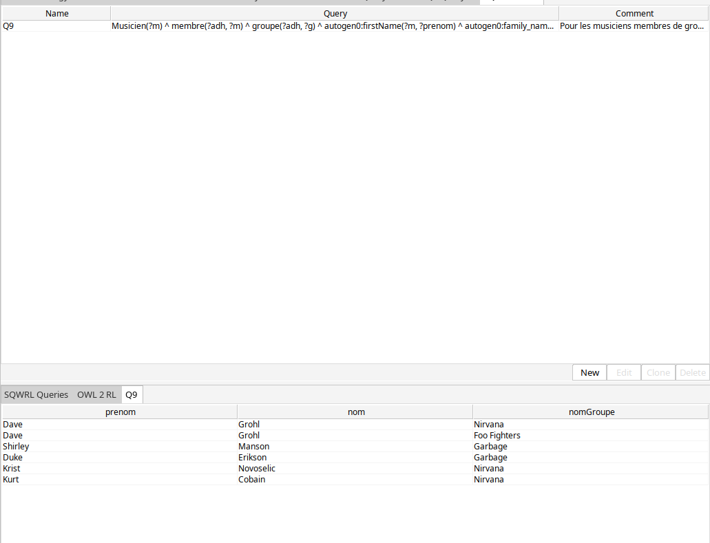
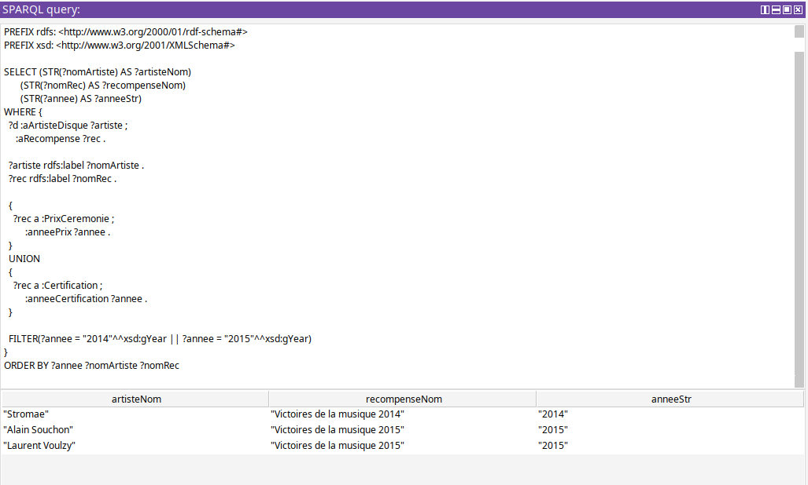

# Ontologie du domaine musical (chansons, groupes, récompenses)

Projet réalisé dans le cadre du cours de Modélisation de Connaissances et Web Sémantique en M1. L'ontologie modélise le domaine musical — musiciens, groupes, chansons, disques, récompenses et certifications — avec un accent particulier sur les relations temporelles entre musiciens et groupes (adhésions, rôles, départs et retours). Le modèle a été construit avec Protégé et validé par une série de requêtes SPARQL et SQWRL.

## Objectif

Concevoir une ontologie OWL capable de répondre à des questions de compétence sur le domaine musical, notamment : qui interprète/compose/écrit une chanson, quelle est la composition d'un groupe à une date donnée ou pour un disque, quels artistes ont reçu quelles récompenses et quand, et comment gérer le cas d'un musicien qui appartient à plusieurs groupes ou qui quitte puis réintègre un groupe.

## Travail réalisé

1. **Conception des classes** (`chansons.ttl`, `Rapport.pdf` section 3) — définition des classes métier (`Musicien` ⊑ `foaf:Person`, `Groupe` ⊑ `foaf:Group`, `Chanson`, `Disque`/`Album`/`Single`, `Recompense`/`PrixCeremonie`/`Certification`) et de la classe intermédiaire clé `AdhesionGroupe`, qui modélise une relation n-aire (musicien, groupe, rôle, période) plutôt qu'un simple lien binaire musicien-groupe.
2. **Intégration de FOAF** — réutilisation de `foaf:Person`, `foaf:Group` et `foaf:Agent` (pour unifier musicien et groupe en tant qu'interprète ou lauréat), en évitant volontairement `foaf:Organization` et `foaf:Member`, insuffisants pour représenter la temporalité et les rôles.
3. **Propriétés objet et de données** — 15 propriétés objet (`aParolier`, `aCompositeur`, `aInterprete`, `aAdhesion`, `membre`, `groupe`, `roleDansGroupe`, `dansDisque`, `aArtisteDisque`, `aRecompense`, `laureat`, `niveauCertification`, `aGenre`, …) et 8 propriétés de données (identité, temporalité `debut`/`fin` en `xsd:gYear`, description des prix et certifications).
4. **Classes inférées** — définition de classes par restriction pour tester le raisonnement (`ChansonRock`, `ChansonAvecPlusieursInterpretes`, `DisqueDiamantFrance`, `PrixVictoires`, `JamaisSolo`, `GroupeMixte`, …), certaines individus (genres, rôles, niveaux de certification) étant modélisés comme instances plutôt que littéraux pour permettre ces restrictions.
5. **Peuplement et validation** — création d'individus de test (Nirvana, Foo Fighters, Garbage, Stromae, Alain Souchon, …) et écriture/exécution de 8 requêtes SPARQL et 2 requêtes SQWRL dans Protégé pour valider le modèle (voir `Rapport.pdf` section 6 et le dossier `Requetes/`).

## Compétences mises en pratique

| Compétence | Application dans ce projet |
|---|---|
| Conception d'ontologies OWL | Modélisation de classes, hiérarchies et restrictions dans Protégé (`chansons.ttl`, `Chansons.owl`) |
| Modélisation de relations n-aires | Classe intermédiaire `AdhesionGroupe` pour représenter (musicien, groupe, rôle, période) sans perte d'information |
| Réutilisation d'ontologies existantes | Intégration raisonnée de FOAF (`foaf:Person`, `foaf:Group`, `foaf:Agent`), avec justification explicite des classes FOAF évitées |
| Raisonnement et classes définies | Classes inférées par restriction (`owl:equivalentClass`) testées avec un reasoner (Pellet/HermiT) |
| Interrogation de graphes RDF avec SPARQL | 8 requêtes couvrant SELECT, ASK, OPTIONAL, FILTER NOT EXISTS, agrégations (COUNT/GROUP BY/HAVING), REGEX |
| Règles SWRL/SQWRL | Écriture de requêtes SQWRL pour extraire des tuples via les relations d'adhésion |
| Débogage de requêtes sémantiques | Diagnostic d'une requête SQWRL non fonctionnelle (limite du langage sur les agrégations groupées), documenté plutôt que masqué |

## Outils utilisés

- **Protégé** — édition de l'ontologie, gestion des individus, exécution des requêtes SPARQL et SQWRL
- **OWL 2** / **Turtle** (`chansons.ttl`) — langage de représentation de l'ontologie
- **FOAF** (`http://purl.org/spar/foaf`) — vocabulaire importé pour les notions de personne/groupe/agent
- **SPARQL** et **SQWRL** — langages de requête utilisés pour la validation
- Reasoner OWL (Pellet/HermiT, selon la configuration Protégé) pour le calcul des classes inférées

## Principaux résultats

Les 8 requêtes SPARQL et la première requête SQWRL ont toutes donné un résultat correct et cohérent avec le modèle (voir `Rapport.pdf` pour le détail requête par requête) ; seule la seconde requête SQWRL (comptage groupé des adhésions féminines par groupe) a échoué pour une limite du langage non résolue dans le temps imparti.

- La requête ASK confirme que le groupe Garbage compte bien une membre féminine (Shirley Manson).
- Le modèle restitue correctement les récompenses par artiste et par année (Stromae, Alain Souchon, Laurent Voulzy — Victoires de la musique 2014/2015).
- La requête SQWRL sur les adhésions retrouve bien les doubles appartenances (Dave Grohl, membre à la fois de Nirvana et de Foo Fighters), validant l'intérêt de la classe `AdhesionGroupe`.

## Exécuter le projet

Dépendance : [Protégé](https://protege.stanford.edu/) (testé avec la version supportant les plugins SPARQL Query et SQWRL Tab).

1. Ouvrir `rendu/Chansons.owl` (ou `chansons.ttl`) dans Protégé.
2. Lancer le reasoner (menu **Reasoner**) pour calculer les classes inférées (section 5 du rapport).
3. Onglet **SPARQL Query** : coller une requête depuis `rendu/Requetes.txt` ou `Rapport.pdf` et l'exécuter.
4. Onglet **SQWRL Tab** : exécuter la règle Q9 pour retrouver le résultat de la section SQWRL-09.

Le rapport de conception complet, avec toutes les requêtes et leurs résultats commentés, se trouve dans [Rapport.pdf](Rapport.pdf).

## Limites et améliorations possibles

- La requête SQWRL-10 (comptage groupé des adhésions féminines par groupe) n'a jamais abouti dans Protégé ; une piste non explorée serait de la reformuler entièrement en SPARQL, plus robuste sur les agrégations groupées.
- Le jeu de données de test reste petit (quelques musiciens, groupes et disques), suffisant pour valider les choix de modélisation mais pas pour représenter un catalogue réaliste à grande échelle.
- Les prix et certifications sont représentés par des littéraux textuels simples (nom, catégorie) plutôt que des individus structurés, ce qui limite les requêtes possibles sur ces catégories.

## Contributrice

Projet réalisé par **Yasmina Farid** dans le cadre du cours de Modélisation de Connaissances et Web Sémantique (M1) : conception de l'ontologie, choix de modélisation (classes, `AdhesionGroupe`, propriétés, classes inférées), peuplement et écriture/validation des requêtes SPARQL et SQWRL.
